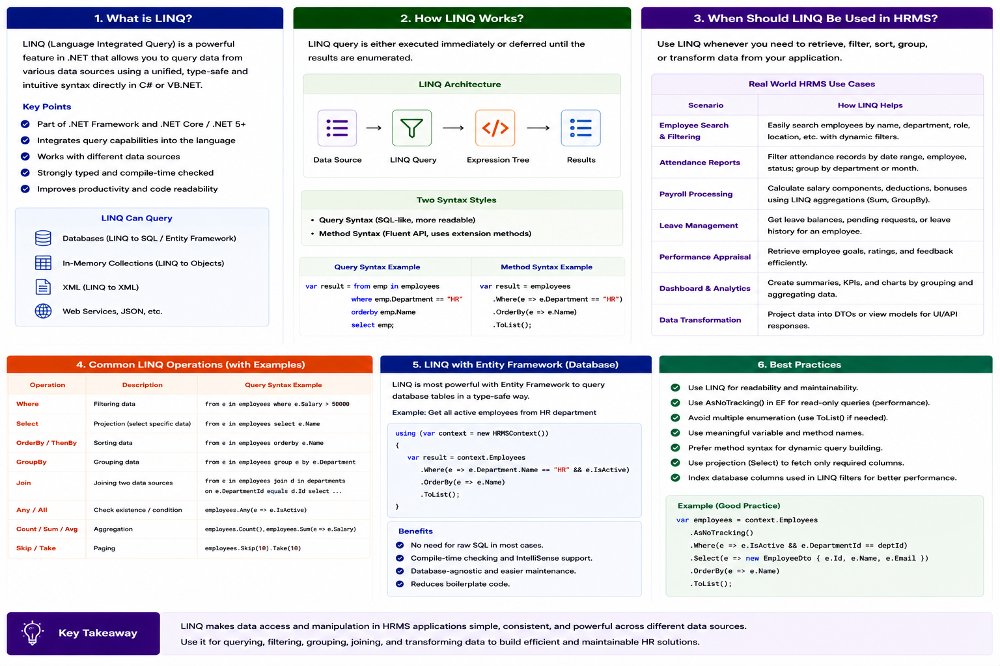

# LINQ

### 📘 **Linq Complete Tutorial**

- **What is LINQ?**
    
    
    
- **Linq In C# ?**
    
    
    
- **Why LINQ?**
    
    
    
- **LINQ API in .NET guide ?**
    
    
    
- **IQueryable vs IEnumerable in LINQ ?**
    
    
    
- **Explain IQueryable ?**
    
    
    
- **Explain IEnumerable ?**
    
    
    
- **Which to use when IEnumerable vs IQueryable ?**
    
    
    
- **In LINQ, what are the two basic syntaxes available to write queries against an `IEnumerable` collection or `IQueryable` data source?**
    
    
    
- **Explain Anatomy of the Lambda Expression in linq  ?**
    
    
    
- **Where clause in Query Syntax ?**
    
    
    
- **Where extension method in Method Syntax ?**
    
    
    
- **Filtering Operator - OfType ?**
    
    
    
- **OrderBy in Linq ?**
    
    
    
- **OrderByDescending ?**
    
    
    
- **ThenBy ?**
    
    
    
- **ThenByDescending ?**
    
    
    
- **Reverse ?**
    
    
    
- **GroupBy ?**
    
    
    
- **ToLookup ?**
    
    
    
- **Join ?**
    
    
    
- **GroupJoin ?**
    
    
    
- **Projection Operators: Select  ?**
    
    
    
- **Projection Operators:  SelectMany ?**
    
    
    
- **Quantifier Operators : All ?**
    
    
    
- **Quantifier Operators : Any ?**
    
    
    
- **Quantifier Operators : Contains ?**
    
    
    
- **Aggregation Operators: Aggregate ?**
    
    
    
- **Aggregation Operators: Average ?**
    
    
    
- **Aggregation Operators: Count ?**
    
    
    
- **Aggregation Operators: LongCount ?**
    
    
    
- **Aggregation Operators: Max ?**
    
    
    
- **Aggregation Operators: Min ?**
    
    
    
- **Aggregation Operators: Sum?**
    
    
    
- **Element Operators: ElementAt ?**
    
    
    
- **Element Operators: ElementAtOrDefault ?**
    
    
    
- **Element Operators: First ?**
    
    
    
- **Element Operators: FirstOrDefault ?**
    
    
    
- **Element Operators: Last ?**
    
    
    
- **Element Operators: LastOrDefault ?**
    
    
    
- **Element Operators: Single ?**
    
    
    
- **Element Operators: SingleOrDefault ?**
    
    
    
- **LINQ Equality Operator: SequenceEqual ?**
    
    
    
- **Concatenation Operator: Concat ?**
    
    
    
- **Generation Operator: DefaultIfEmpty ?**
    
    
    
- **Generation Operators: Empty ?**
    
    
    
- **Generation Operators: Range ?**
    
    
    
- **Generation Operators:  Repeat ?**
    
    
    
- **Set Operator: Distinct ?**
    
    
    
- **Set Operator: Except ?**
    
    
    
- **Set Operator: Intersect ?**
    
    
    
- **Set Operator: Union ?**
    
    
    
- **Partitioning Operators: Skip ?**
    
    
    
- **Partitioning Operators:  SkipWhile ?**
    
    
    
- **Partitioning Operators: Take ?**
    
    
    
- **Partitioning Operators: TakeWhile ?**
    
    
    
- 
- 
- 
- 
- 
- 
- 
- 
- 
- 
- 
- 
- 
- 
- 
- 
- 
- 
- 
-