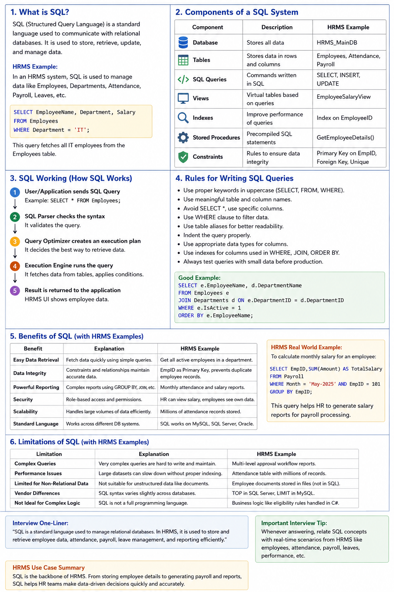

# Sql

### 📘 **SQL Commands** – Questions

- **What Is Structured Query Language (SQL)**?
    
    
    
- **SQL commands: DDL ?**
    
    
    
- **SQL commands:  DML ?**
    
    
    
- **SQL commands:  DCL ?**
    
    
    
- **SQL commands: TCL ?**
    
    
    
- **SQL commands: DQL ?**
    
    
    

---

### 📘 **SQL for Beginners – Questions**

- **What is a Relational Database?**
    
    
    
- **How is Data Stored in a Relational Database? and What is a Schema in a Relational Database?**
    
    
    

---

### 📘 SQL Data Types – Questions

- **What are the Numeric Data Types in SQL ?**
    
    
    
- **What are the different string data types in SQL ?**
    
    
    
- **What is the purpose of date/time data types ?**
    
    
    
- **What is the Binary Data Types in SQL ?**
    
    
    
- **What Is the Boolean Data types in SQL ?**
    
    
    
- **What are XML Data Type in sql ?**
    
    
    
- **What are Spatial Data Type Type in sql ?**
    
    
    

---

### 📘 SQL Operators – Questions

- **Explain Arithmetic Operators  in Sql ?**
    
    
    
- **Explain Comparison Operators  in Sql ?**
    
    
    
- **Explain Logical Operators  in Sql ?**
    
    
    
- **Explain Bitwise Operators  in Sql ?**
    
    
    
- **Explain Compound Operators  in Sql ?**
    
    
    
- **Explain Special Operators  in Sql ?**
    
    
    
- **What is the difference between `UNION` and `UNION ALL` in SQL?**
    
    
    

### 📘 **SQL Database** – Questions

- **SQL DATABASE ?**
    
    
    
- **SQL Create/DROP/Query/Select/Query to Rename   DATABASE ?**
    
    
    
- **Difference Between SQL and NoSQL Databases ?**
    
    
    

---

### 📘 **SQL Tables** – Questions

- **SQL CREATE TABLE ?**
    
    
    
- **SQL DROP TABLE ?**
    
    
    
- **SQL ALTER TABLE ?**
    
    
    
- **ALTER (RENAME) in SQL ?**
    
    
    
- **SQL TRUNCATE TABLE ?**
    
    
    
- **SQL Cloning or Copying a Table ?**
    
    
    
- **Temporary Table in SQL ?**
    
    
    

---

### 📘 **SQL Queries** – Questions

- **SQL SELECT Query ?**
    
    
    
- **SQL INSERT INTO Statement ?**
    
    
    
- **SQL Query to Insert Multiple Rows ?**
    
    
    
- **SQL UPDATE Statement ?**
    
    
    
- **SQL DELETE Statement ?**
    
    
    
- **SQL Query to Delete Duplicate Rows ?**
    
    
    
- **What is Aliases in SQL ?**
    
    
    

---

### 📘 SQL Joins

- **What is an `INNER JOIN`,  and when should it be use it?**
    
    
    
- **What is a LEFT JOIN, and when should it be use it ?**
    
    
    
- **SQL RIGHT JOIN and when should it be use it?**
    
    
    
- **SQL FULL JOIN and when should it be use it?**
    
    
    
- **SQL Outer Join and when should it be use it?**
    
    
    
- **SQL LEFT JOIN and when should it be use it?**
    
    
    
- **SQL CROSS JOIN and when should it be use it?**
    
    
    
- **SQL Self Join and when should it be use it?**
    
    
    
- **SQL | UPDATE with JOIN and when should it be use it?**
    
    
    
- **SQL DELETE JOIN and when should it be use it?**
    
    
    
- **Recursive Join in SQL and when should it be use it?**
    
    
    

---

### 📘 SQL Functions

- **SQL | Date Functions ?**
    
    
    
- **SQL | String functions ?**
    
    
    
- **SQL | Numeric Functions ?**
    
    
    
- **SQL - Statistical Functions ?**
    
    
    
- **Working With JSON in SQL ?**
    
    
    
- **Conversion Function in SQL ?**
    
    
    
- **SQL LTRIM() Function ?**
    
    
    
- **SQL UPPER() Function ?**
    
    
    
- **SQL RTRIM() Function ?**
    
    
    

---

### 📘 SQL Constraints – Questions

- **What does the NOT NULL constraint ensure?**
    
    
    
- **What is a Primary Key in SQL, and how is it used?**
    
    
    
- **What is a Composite Key in SQL  in SQL, and how is it used?**
    
    
    
- **What is a SQL ALTERNATE KEY in SQL, and how is it used?**
    
    
    
- **What is a Foreign Key, and how does it maintain relationships between tables?**
    
    
    
- **What is a CHECK constraint in SQL, and when would you use it?**
    
    
    
- **How does the UNIQUE constraint work in SQL?**
    
    
    
- **What is the purpose of the DEFAULT constraint, and how is it defined?**
    
    
    

---

### 📘 **SQL Aggregate Functions**

- **SQL Aggregate Functions ?**
    
    
    
- **SQL Count() Function ?**
    
    
    
- **SQL SUM() Function ?**
    
    
    
- **SQL MIN() Function ?**
    
    
    
- **SQL MAX() Function ?**
    
    
    
- **AVG() Function in SQL ?**
    
    
    

---

### 📘 SQL Clauses

- **What is the purpose of the `DISTINCT` clause in SQL?**
    
    
    
- **What is SQL - WHERE Clause ?**
    
    
    
- **What is SQL GROUP BY?**
    
    
    
- **What is SQL HAVING Clause ?**
    
    
    
- **What is SQL ORDER BY ?**
    
    
    
- **What is SQL LIMIT Clause ?**
    
    
    
- **What is the `TOP` clause?**
    
    
    
- **What is the order of execution in an SQL query?**
    
    
    
- **What is a sub-query, and where can it be used in SQL?**
    
    
    
- **What is a CTE (Common Table Expression), and how is it created using the `WITH` clause?**
    
    
    

---

### 📘 Normalization in SQL – Questions

- **What is normalization in SQL and why is it important?**
    
    
    
- **What are the characteristics of 1NF (First Normal Form)?**
    
    
    
- **How does 2NF (Second Normal Form) differ from 1NF?**
    
    
    
- **What is 3NF (Third Normal Form) and how does it improve data integrity?**
    
    
    
- **What is BCNF (Boyce-Codd Normal Form), and when should it be used?**
    
    
    

---

### 📘 SQL CASE Statement – Questions

- **Explain SQL CASE Statement ?**
    
    
    
- **What is a nested CASE statement and when would you use one?**
    
    
    

---

### 📘 SQL In-Built Functions – Questions

- **Explain string functions in SQL like `SUBSTRING()` used for?**
    
    
    
- **Explain string functions in SQL like  `POSITION()` used for?**
    
    
    
- **Explain string functions in SQL like  `COALESCE()` used for?**
    
    
    
- **Explain string functions in SQL like  Len`()` used for?**
    
    
    
- **Explain string functions in SQL like  Left`()` used for?**
    
    
    
- **Explain string functions in SQL like  Right`()` used for?**
    
    
    
- **Explain string functions in SQL like  Upper`()` used for?**
    
    
    
- **Explain string functions in SQL like  Lower`()` used for?**
    
    
    
- **Explain string functions in SQL like  TRIM`()` used for?**
    
    
    
- **Explain string functions in SQL like  REPLACE`()` used for?**
    
    
    
- **Explain string functions in SQL like  CHARINDEX`()` used for?**
    
    
    
- **Explain string functions in SQL like  CONCAT`()` used for?**
    
    
    
- **Explain string functions in SQL like  LTRIM`()` used for?**
    
    
    
- **Explain string functions in SQL like  RTRIM`()` used for?**
    
    
    
- **Explain string functions in SQL like  STUFF`()` used for?**
    
    
    
- **Explain string functions in SQL like  REVERSE`()` used for?**
    
    
    
- **Explain string functions in SQL like  FORMAT`()` used for?**
    
    
    
- **Explain string functions in SQL like  ISNULL`()` used for?**
    
    
    

---

### 📘 SQL Window Functions – Questions

- **What are window functions in SQL, and how do they differ from aggregate functions?**
    
    
    
- **What is the purpose of the `RANK()` function in SQL?**
    
    
    
- **How does `DENSE_RANK()` differ from `RANK()`?**
    
    
    
- **What does the `ROW_NUMBER()` function do?**
    
    
    
- **Explain the use cases for the `LEAD()` and `LAG()` functions.**
    
    
    
- **What do functions like `FIRST_VALUE()`, `LAST_VALUE()`, `NTH_VALUE()`, and `NTILE()` do in windowing?**
    
    
    

---

### 📘 SQL Views – Questions

- **What is a view in SQL, and how does it differ from a table?**
    
    
    
- **SQL UPDATE VIEW ?**
    
    
    
- **SQL - Rename View ?**
    
    
    
- **How do you drop a view in SQL?**
    
    
    
- **Can you update data through a view? Under what conditions is this possible?**
    
    
    
- **What is a materialized view, and how is it different from a regular view?**
    
    
    
- **How can views be used to simplify complex queries and What are the performance implications of using views?**
    
    
    

---

### 📘 Advanced SQL Topics – Questions

- **What are recursive SQL queries, and how are they used? Provide an example scenario.**
    
    
    
- **What is a PIVOT table in SQL, and how does it work?**
    
    
    
- **Explain the CROSSTAB function and how it differs from the PIVOT operation.**
    
    
    
- **What is a stored procedure in SQL, and how is it created?**
    
    
    
- **How do stored procedures improve database operations and security?**
    
    
    
- **What are user-defined functions (UDFs) in SQL?**
    
    
    
- **How do user-defined functions differ from stored procedures?**
    
    
    

---

### 📘 Database Jobs – Questions

- **What is a database job, and how is it used in database management?**
    
    
    
- **How do you schedule a job in SQL Server ?**
    
    
    
- **What are some common tasks automated using database jobs?**
    
    
    

---

### 📘 Database Triggers – Questions

- **What is a trigger in a database?**
    
    
    
- **What are the different types of triggers (e.g., BEFORE, AFTER, INSTEAD OF)?**
    
    
    
- **How can triggers be used to enforce business rules or data integrity?**
    
    
    
- **What are potential drawbacks or risks of using triggers excessively?**
    
    
    
- **What are the potential downsides of using too many indexes?**
    
    
    

---

### 📘 Database Migration – Questions

- **What is database migration, and why is it necessary?**
    
    
    
- **What are common challenges faced during database migration?**
    
    
    
- **What tools or methods are used for migrating databases in ssms ?**
    
    
    

---

### 📘 Indexes – Questions

- **What is an index in a database, and how does it improve query performance?**
    
    
    
- **What are the different types of indexes (e.g., clustered vs non-clustered)?**
    
    
    

---

### 📘 Temporary Tables – Questions

- **What is a temporary table, and how does it differ from a regular table and When would you use a temporary table in SQL?**
    
    
    

---

### 📘 Dynamic Execution of SQL Statements – Questions

- **What does dynamic SQL mean and How can dynamic SQL be executed in SQL ?**
    
    
    

---

### 📘 PL/SQL Concepts – Questions

- **What are variables in SQL, and how are they declared?**
    
    
    
- **What is a cursor, and why is it used?**
    
    
    
- **What are collection types in SQL?**
    
    
    
- **How are loop statements structured in SQL?**
    
    
    
- **How do IF ELSE statements work in SQL?**
    
    
    
- **What is exception handling in SQL?**
    
    
    
- **What are packages in SQL, and what advantages do they offer?**
    
    
    

---

### 📘 Performance Tuning – Questions

- What is an **explain plan**, and how does it help optimize queries?
    
    
    
- How do **table statistics** impact query performance?
    
    
    
- What is **table partitioning**, and how does it help with performance?
    
    
    
- What is **DBMS\_Profiler**, and how is it used?
    
    
    
- What are **SQL Trace** and **TKProf**, and how do they assist in performance tuning?
    
    
    

---

### 📘 Database Backup – Questions

- What are the different types of **database backups** (full, differential, transaction log)?
    
    
    
- Why is regular database backup important?
    
    
    
- What are the best practices for storing and managing database backups?
    
    
    

---

- What is a **Facade Layer**?
    
    
    
- How SQL Server stores data internally (pages, extents, B-tree indexes) ?
    
    