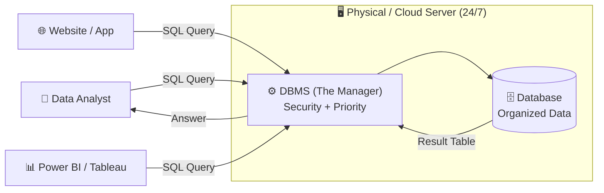
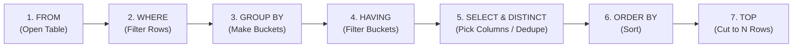
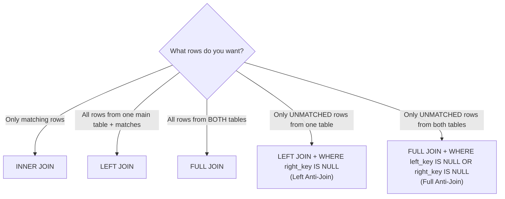
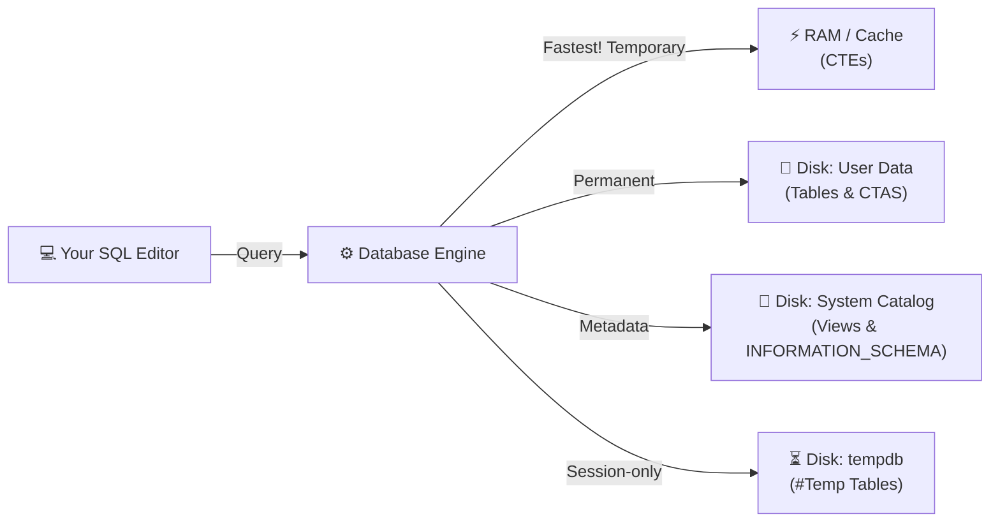

# Complete SQL Beginner-to-Pro Notes (With Animated Visual Examples)

> **Source:** Complete SQL Course Transcript (`Sql.txt`) by Barzalini  
> **Level:** Absolute Beginner -> Intermediate -> Advanced -> Real-World Projects  
> **Database Focus:** Microsoft SQL Server (T-SQL), with cross-database tips for MySQL & PostgreSQL

---

## Table of Contents

1. [Chapter 1: Introduction to SQL & Databases](#chapter-1-introduction-to-sql--databases)
2. [Chapter 2: Environment & Database Setup](#chapter-2-environment--database-setup)
3. [Chapter 3: Querying Data Basics (DQL)](#chapter-3-querying-data-basics-dql)
4. [Chapter 4: Defining Database Structure (DDL)](#chapter-4-defining-database-structure-ddl)
5. [Chapter 5: Manipulating Data (DML)](#chapter-5-manipulating-data-dml)
6. [Chapter 6: Filtering Data (Intermediate)](#chapter-6-filtering-data-intermediate)
7. [Chapter 7: Combining Data — SQL Joins](#chapter-7-combining-data--sql-joins)
8. [Chapter 8: Combining Data — Set Operators](#chapter-8-combining-data--set-operators)
9. [Chapter 9: Row-Level Functions (Data Cleaning & Prep)](#chapter-9-row-level-functions-data-cleaning--prep)
10. [Chapter 10: Aggregate & Window (Analytical) Functions](#chapter-10-aggregate--window-analytical-functions)
11. [Chapter 11: Advanced SQL Techniques](#chapter-11-advanced-sql-techniques)
12. [Chapter 12: Performance Optimization & Indexing](#chapter-12-performance-optimization--indexing)
13. [Chapter 13: Using AI (ChatGPT & GitHub Copilot) for SQL](#chapter-13-using-ai-chatgpt--github-copilot-for-sql)
14. [Chapter 14: Real-World SQL Projects](#chapter-14-real-world-sql-projects)

---

## Chapter 1: Introduction to SQL & Databases

### 1.1 What is Data & Why Do We Need Databases?
Everything around you generates **data** — your name, your phone contacts, your bank statements, and every item a store sells.
Personally, you might store data in **Excel spreadsheets** or **text files**. Companies, however, generate millions of rows of data every day. Spreadsheets break down here because:
- Searching across hundreds of separate files is slow and messy.
- Spreadsheets crash or freeze with millions of rows.
- Anyone with the file can see or accidentally edit sensitive data (no security).

A **Database** solves this: think of it as a **smart, organized, secure digital container** built to store massive amounts of data so you can search and manage it in milliseconds.

### 1.2 What is SQL?
**SQL** stands for **Structured Query Language** (pronounced *"S-Q-L"* or *"sequel"*). It is the universal language you use to **talk to a database** — to ask questions, fetch data, add new records, or build tables.

### 1.3 How Databases Work in Real Companies (Animated Flow)
In a company, many people and apps talk to the database at the same time. They don't touch the raw files directly — a manager software called a **DBMS (Database Management System)** handles every request, checks security, and decides which query runs first. Everything lives on a powerful 24/7 computer called a **Server**.



### 1.4 Types of Databases
1. **Relational Databases (SQL):** Store data in **tables** (rows & columns) that connect to each other.  
   *Examples:* **Microsoft SQL Server** (used in this course), MySQL, PostgreSQL, Oracle.
2. **NoSQL Databases:** Store data in non-table formats for special use cases:
   - *Key-Value:* Redis, Amazon DynamoDB
   - *Column-based:* Cassandra, Amazon Redshift
   - *Graph:* Neo4j
   - *Document:* MongoDB

### 1.5 Inside a Relational Database (Hierarchy & Building Blocks)
Think of a database like a filing cabinet:
```text
🖥️ Server (Building)
 └── 🗄️ Database: SalesDB (Filing Cabinet)
      └── 📁 Schema: sales (Drawer / Category)
           └── 📋 Table: customers (Spreadsheet)
                ├── 🔑 Primary Key: id (Unique fingerprint per row — NO duplicates!)
                ├── 🧱 Columns / Fields (e.g., first_name, country, score)
                └── 📄 Rows / Records (e.g., 1, Maria, Germany, 350)
```

**Common SQL Data Types:**
| Data Type | What It Stores | Example |
| :--- | :--- | :--- |
| `INT` | Whole numbers | `1`, `350`, `-10` |
| `DECIMAL` | Numbers with decimals | `3.14`, `99.95` |
| `CHAR(n)` | Fixed-length text (always uses `n` spaces) | `'US'`, `'DE'` |
| `VARCHAR(n)` | Variable-length text (saves space) | `'Maria'`, `'Germany'` |
| `DATE` / `TIME` | Calendar dates and clock times | `'2025-08-20'` |

### 1.6 The 3 Main Families of SQL Commands
| Family | Full Name | What It Does | Commands |
| :--- | :--- | :--- | :--- |
| **DQL** | Data Query Language | **Reads** data (asks questions) | `SELECT` |
| **DDL** | Data Definition Language | **Builds/changes** table structure | `CREATE`, `ALTER`, `DROP` |
| **DML** | Data Manipulation Language | **Changes** data inside tables | `INSERT`, `UPDATE`, `DELETE` |

> **Top 3 Reasons to Learn SQL:** (1) It's how you talk to company data, (2) Huge job demand (Analysts, Engineers, Scientists), (3) It's built into Power BI, Tableau, Spark, Kafka, and Cloud platforms.

---

## Chapter 2: Environment & Database Setup

### 2.1 Tools Used in This Course
1. **Microsoft SQL Server Express Edition:** Free, lightweight database engine (choose *Basic* installation).
2. **SSMS (SQL Server Management Studio):** The visual app where you write and run SQL queries.
   - Connect using **Windows Authentication** (Server name: `YourPCName\SQLEXPRESS`, check *Trust Server Certificate*).

### 2.2 Two Ways to Load Course Databases
1. **Run `.sql` Setup Scripts:**
   - `init_sql_server_my_database.sql` -> Creates **`MyDatabase`** (beginner-friendly: `customers` with 5 rows, `orders` with 4 rows).
   - `init_sql_server_sales_db.sql` -> Creates **`SalesDB`** (5 realistic tables: `customers`, `employees`, `orders`, `orders_archive`, `products`).
2. **Restore a `.bak` Backup File:**
   - Copy `.bak` (e.g., `AdventureWorksDW`) into SQL Server's `MSSQL\Backup` folder -> Right-click *Databases* in SSMS -> *Restore Database* -> *Device* -> *Add*.

---

## Chapter 3: Querying Data Basics (DQL)

> 💡 **Golden Rule for Beginners:** Queries (`SELECT`) **only read** data. You cannot break or delete anything in the database with a `SELECT` query!

### 3.1 `SELECT` and `FROM`
```sql
USE MyDatabase; -- Switch to the right database

-- Single-line comment
/* Multi-line
   comment */

SELECT * FROM customers;
```
- `*` means **"all columns"**.
- `FROM` tells SQL **which table** to open first.

#### 🎬 Animated Example: `SELECT first_name, country FROM customers;`
```text
[Frame 1: FROM customers]              [Frame 2: SELECT first_name, country]
+----+------------+---------+-------+   +------------+---------+
| id | first_name | country | score |   | first_name | country |
+----+------------+---------+-------+   +------------+---------+
|  1 | Maria      | Germany |   350 |   | Maria      | Germany |
|  2 | John       | USA     |   900 |   | John       | USA     |
|  3 | Georg      | UK      |   750 |   | Georg      | UK      |
|  4 | Martin     | Germany |   500 |   | Martin     | Germany |
|  5 | Peter      | USA     |     0 |   | Peter      | USA     |
+----+------------+---------+-------+   +------------+---------+
                                         (id & score columns hidden)
```
> **Rule:** Never put a trailing comma after the last column in `SELECT`.

### 3.2 `WHERE` — Filtering Rows
Filters rows **before** showing the result. Text values need **single quotes** (`'Germany'`); numbers do not (`0`).
```sql
SELECT first_name, country
FROM customers
WHERE country = 'Germany';
```

#### 🎬 Animated Example: `FROM` -> `WHERE score != 0` -> `SELECT`
```text
[Frame 1: FROM customers]          [Frame 2: WHERE score != 0]        [Frame 3: SELECT *]
id=1, Maria,  Germany, 350  --->   ✅ Keep (350 != 0)                 Maria  | 350
id=2, John,   USA,     900  --->   ✅ Keep (900 != 0)                 John   | 900
id=3, Georg,  UK,      750  --->   ✅ Keep (750 != 0)                 Georg  | 750
id=4, Martin, Germany, 500  --->   ✅ Keep (500 != 0)                 Martin | 500
id=5, Peter,  USA,       0  --->   ❌ Drop (0 == 0)
```

### 3.3 `ORDER BY` — Sorting Results (and Nested Sorting)
- `ASC` = Lowest to Highest (A → Z, 1 → 100). This is the default, but **always write `ASC` explicitly** for clarity.
- `DESC` = Highest to Lowest (Z → A, 100 → 1).
- **Nested Sorting:** Sort by multiple columns; the second column breaks ties in the first!

```sql
SELECT *
FROM customers
ORDER BY country ASC, score DESC;
```

#### 🎬 Animated Example: Nested Sorting (`country ASC, score DESC`)
```text
[Frame 1: Sort by country ASC]     [Frame 2: Break ties with score DESC]
Germany | Maria  | 350             Germany | Martin | 500   <-- 500 moves above 350!
Germany | Martin | 500     ===>    Germany | Maria  | 350
UK      | Georg  | 750             UK      | Georg  | 750
USA     | John   | 900             USA     | John   | 900
USA     | Peter  |   0             USA     | Peter  |   0
```

### 3.4 `GROUP BY` & Column Aliases (`AS`)
`GROUP BY` squashes rows with the same value into **one summary row** per group, then runs a math function (`SUM`, `COUNT`, `AVG`) on each group.
- **Alias (`AS`):** Gives a temporary readable name to a result column (does not rename the real table).
- **Strict Rule:** Every column in `SELECT` that is *not* inside an aggregate function (`SUM`, `COUNT`, etc.) **must** appear in `GROUP BY`.

```sql
SELECT
    country AS customer_country,
    SUM(score) AS total_score,
    COUNT(id) AS total_customers
FROM customers
GROUP BY country;
```

#### 🎬 Animated Example: `GROUP BY country`
```text
[Frame 1: Raw Rows]                [Frame 2: Group Buckets]           [Frame 3: Aggregate & Output]
Maria  | Germany | 350  \          📦 Germany: [350, 500]     ===>    Germany | 850 | 2
Martin | Germany | 500  /          📦 UK:      [750]          ===>    UK      | 750 | 1
Georg  | UK      | 750  ---        📦 USA:     [900, 0]       ===>    USA     | 900 | 2
John   | USA     | 900  \
Peter  | USA     |   0  /
```

### 3.5 `HAVING` vs. `WHERE`
- **`WHERE`** filters **individual rows *before*** grouping.
- **`HAVING`** filters **grouped buckets *after*** `GROUP BY`.

```sql
-- Find average score per country (ignoring score = 0), keeping only countries with AVG > 430
SELECT country, AVG(score) AS avg_score
FROM customers
WHERE score != 0
GROUP BY country
HAVING AVG(score) > 430;
```

### 3.6 `DISTINCT` and `TOP`
- `DISTINCT`: Removes duplicate rows (`SELECT DISTINCT country FROM customers;`). *Tip: Don't use `DISTINCT` on already-unique columns like `id` — deduplicating costs extra work.*
- `TOP N`: Returns only the first `N` rows (called `LIMIT` in MySQL/Postgres). Always pair with `ORDER BY` when finding "Top 3 highest" or "2 most recent".
```sql
SELECT TOP 3 * FROM customers ORDER BY score DESC;
```

### 3.7 Coding Order vs. SQL Execution Order (Crucial!)
You **write** SQL in one order, but the database **runs** it in a completely different order!



| Coding Order (How You Type It) | Execution Order (How SQL Runs It) |
| :--- | :--- |
| 1. `SELECT` (`DISTINCT`, `TOP`) | 1. `FROM` |
| 2. `FROM` | 2. `WHERE` |
| 3. `WHERE` | 3. `GROUP BY` |
| 4. `GROUP BY` | 4. `HAVING` |
| 5. `HAVING` | 5. `SELECT` / `DISTINCT` |
| 6. `ORDER BY` | 6. `ORDER BY` -> `TOP` |

**Bonus Querying Tricks:**
- Separate multiple queries with `;` to get multiple result grids.
- **Static values:** `SELECT id, first_name, 'New Customer' AS customer_type FROM customers;` adds a fixed label column.
- **Partial execution:** Highlight just part of a query in SSMS and press Execute to run only that piece.

---

## Chapter 4: Defining Database Structure (DDL)

DDL commands change the **skeleton/blueprint** of your database (tables and columns).

### 4.1 `CREATE TABLE`
```sql
CREATE TABLE persons (
    id INT NOT NULL,
    person_name VARCHAR(50) NOT NULL,
    birth_date DATE,
    phone VARCHAR(15) NOT NULL,
    CONSTRAINT pk_persons PRIMARY KEY (id)
);
```
- `NOT NULL` means this column cannot be left blank.
- `PRIMARY KEY (id)` guarantees every `id` is unique.

### 4.2 `ALTER TABLE` (Modify Structure)
- **Add a column** (always added at the **end** of the table):
  ```sql
  ALTER TABLE persons ADD email VARCHAR(50) NOT NULL;
  ```
- **Remove a column** (deletes the column and all data inside it):
  ```sql
  ALTER TABLE persons DROP COLUMN phone;
  ```

### 4.3 `DROP TABLE` (Delete Table Completely)
```sql
DROP TABLE persons; -- Removes both the structure AND all data!
```

#### 🎬 Animated Example: DDL Lifecycle
```text
[CREATE TABLE]                 [ALTER TABLE ADD email]              [DROP TABLE]
+----+-------------+------+    +----+-------------+------+-------+
| id | person_name | ...  | -> | id | person_name | ...  | email | -> 💥 Table Gone!
+----+-------------+------+    +----+-------------+------+-------+
(Empty table created)          (New column appended at the right)
```

---

## Chapter 5: Manipulating Data (DML)

DML commands add, change, or remove **rows** inside an existing table.

### 5.1 `INSERT` — Adding New Rows
**Method 1: Manual `VALUES`**
```sql
INSERT INTO customers (id, first_name, country, score)
VALUES
    (6, 'Anna', 'USA', NULL),
    (7, 'Sam', NULL, 100);
```
- **Rules & Pitfalls:**
  - Column count and order must match the values!
  - Cannot put `NULL` into a `NOT NULL` or Primary Key column (`id`).
  - You can skip nullable columns: `INSERT INTO customers (id, first_name) VALUES (10, 'Sara');` (`country` and `score` automatically become `NULL`).

**Method 2: `INSERT INTO ... SELECT` (Copy from Another Table)**
> **Best Practice:** Always run and verify the `SELECT` query *first*, then add `INSERT INTO` above it.
```sql
INSERT INTO persons (id, person_name, birth_date, phone)
SELECT id, first_name, NULL, 'Unknown'
FROM customers;
```

### 5.2 `UPDATE` — Changing Existing Rows
> ⚠️ **Safety Rule:** **NEVER** run `UPDATE` without a `WHERE` clause unless you truly want to overwrite *every single row* in the table! Always test your `WHERE` condition with a `SELECT *` first.

```sql
-- Test first: SELECT * FROM customers WHERE id = 10;
UPDATE customers
SET score = 0, country = 'UK'
WHERE id = 10;
```

### 5.3 `DELETE` vs. `TRUNCATE` — Removing Rows
- **`DELETE`:** Removes specific rows matching `WHERE` (logs every row, slower on huge tables).
  ```sql
  DELETE FROM customers WHERE id > 5;
  ```
- **`TRUNCATE`:** Wipes **all** rows instantly while keeping the empty table structure (skips detailed logging, much faster for clearing big tables).
  ```sql
  TRUNCATE TABLE persons;
  ```

#### 🎬 Animated Example: `DELETE` vs `TRUNCATE`
```text
DELETE FROM customers WHERE id > 5;      TRUNCATE TABLE persons;
Row 1..5: ✅ Untouched                   All rows: ⚡ Instantly wiped!
Row 6:    🗑️ Deleted (logged)            Table skeleton: ✅ Still exists
Row 7:    🗑️ Deleted (logged)
```

---

## Chapter 6: Filtering Data (Intermediate)

Filtering is how you tell SQL *"only show me the rows I care about."* There are **5 groups of operators**:

### 6.1 Comparison Operators
Compare two values (`=`, `!=` or `<>`, `>`, `>=`, `<`, `<=`):
```sql
SELECT * FROM customers WHERE score >= 500;
SELECT * FROM customers WHERE country != 'Germany';
```

### 6.2 Logical Operators (`AND`, `OR`, `NOT`)
- **`AND`:** Both conditions must be true.
- **`OR`:** At least one condition must be true.
- **`NOT`:** Flips true to false (and false to true).
```sql
SELECT * FROM customers WHERE country = 'USA' AND score > 500;
SELECT * FROM customers WHERE country = 'USA' OR score > 500;
SELECT * FROM customers WHERE NOT score < 500; -- Same as score >= 500
```

### 6.3 Range Operator (`BETWEEN`)
Checks if a value falls inside a range (**inclusive** of both ends):
```sql
SELECT * FROM customers WHERE score BETWEEN 100 AND 500;
-- Instructor tip: score >= 100 AND score <= 500 is even clearer!
```

### 6.4 Membership Operator (`IN` / `NOT IN`)
Cleaner and faster than writing `country = 'Germany' OR country = 'USA'`:
```sql
SELECT * FROM customers WHERE country IN ('Germany', 'USA');
```

### 6.5 Search Operator (`LIKE`) — Pattern Matching
Uses two wildcards inside single quotes:
- **`%`** = Zero, one, or **any number** of characters.
- **`_`** = **Exactly one** character.

#### 🎬 Animated Example: `LIKE` Pattern Scanner
```text
Pattern: '__r%'  (Any 2 chars, then 'r', then anything)

'Maria'  -> [M][a][r][ia]   -> 3rd letter is 'r' -> ✅ MATCH!
'Martin' -> [M][a][r][tin]  -> 3rd letter is 'r' -> ✅ MATCH!
'Peter'  -> [P][e][t][er]   -> 3rd letter is 't' -> ❌ NO
'John'   -> [J][o][h][n]    -> 3rd letter is 'h' -> ❌ NO
```
Other handy patterns: `'M%'` (starts with M), `'%n'` (ends with n), `'%r%'` (contains r anywhere).

---

## Chapter 7: Combining Data — SQL Joins

### 7.1 Joins vs. Set Operators (Big Picture)
- **Joins:** Glue tables **side-by-side** (adds more **columns** using a matching key like `customer_id`).
- **Set Operators:** Stack tables **top-to-bottom** (adds more **rows**).

```text
JOINS (Side-by-Side)               SET OPERATORS (Top-to-Bottom)
[Table A] + [Table B]              [Table A]
                                   ---------
                                   [Table B]
```

**3 Reasons We Use Joins:** (1) Recombine split tables, (2) Enrich a table with extra details (like adding customer names to orders), (3) Check if rows exist or are missing in another table.

### 7.2 Basic Joins (Animated Row Matching)
Suppose we have `customers (c)` with IDs `1, 2, 3, 4, 5` and `orders (o)` with `customer_id` `1, 2, 3, 6`:

```text
customers (Left)          orders (Right)
id | name                 order_id | customer_id | sales
---+-------               ---------+-------------+------
1  | Maria   <--Match-->  1001     | 1           | 35
2  | John    <--Match-->  1002     | 2           | 15
3  | Georg   <--Match-->  1003     | 3           | 20
4  | Martin  (No order)   1004     | 6           | 10   (No customer!)
5  | Peter   (No order)
```

| Join Type | What It Keeps | Result IDs Kept |
| :--- | :--- | :--- |
| **`INNER JOIN`** | **Only matching** rows in both tables | `1, 2, 3` |
| **`LEFT JOIN`** | **All** from Left + matching from Right (`NULL` if no match) | `1, 2, 3, 4(NULL), 5(NULL)` |
| **`RIGHT JOIN`** | **All** from Right + matching from Left (`NULL` if no match) | `1, 2, 3, 6(NULL)` |
| **`FULL JOIN`** | **All** rows from both tables (`NULL` where unmatched) | `1, 2, 3, 4, 5, 6` |

```sql
-- Always prefix columns with table aliases (c., o.) to avoid ambiguity!
SELECT c.id, c.first_name, o.order_id, o.sales
FROM customers AS c
LEFT JOIN orders AS o
    ON c.id = o.customer_id;
```
> **Best Practice:** Avoid `RIGHT JOIN` — instead, swap the table order and use `LEFT JOIN` so all queries read consistently left-to-right!

### 7.3 Advanced Joins (Anti-Joins & Cross Join)
- **Left Anti-Join:** Rows in Left with **NO** match in Right (e.g., *customers who never ordered*).
  ```sql
  SELECT * FROM customers c
  LEFT JOIN orders o ON c.id = o.customer_id
  WHERE o.customer_id IS NULL;
  ```
- **Right Anti-Join:** Rows in Right with **NO** match in Left (`RIGHT JOIN ... WHERE c.id IS NULL`).
- **Full Anti-Join:** Unmatched rows from **both** sides (`FULL JOIN ... WHERE c.id IS NULL OR o.customer_id IS NULL`).
- **Cross Join:** Pairs **every** row from Table A with **every** row from Table B (5 × 4 = 20 rows, no `ON` clause). Great for generating test data or size×color combinations.

### 7.4 How to Choose the Right Join (Decision Flowchart)


### 7.5 Joining Multiple Tables (`SalesDB` Pattern)
Start with your main transaction table (`sales.orders o`) and `LEFT JOIN` each lookup table (`customers`, `products`, `employees`), renaming duplicate column names with `AS`.

---

## Chapter 8: Combining Data — Set Operators

Set operators stack the results of two `SELECT` queries **on top of each other**.

### 8.1 The 6 Golden Rules of Set Operators
1. `ORDER BY` can only appear **once at the very end** of the combined query.
2. Both queries must return the **exact same number of columns**.
3. Matching columns must have **compatible data types**.
4. Columns are matched **by position** (1st to 1st, 2nd to 2nd), not by name.
5. Column names in the final output come from the **first** `SELECT` query.
6. SQL won't stop you from stacking `first_name` under `last_name` — **you** must ensure the meaning matches!

### 8.2 The 4 Set Operators (Animated Comparison)
Suppose Query A returns `{1, 2, 3}` and Query B returns `{3, 4, 5}`:

```text
UNION (Combines & removes duplicates):      [1, 2, 3, 4, 5]
UNION ALL (Combines & KEEPS duplicates):    [1, 2, 3, 3, 4, 5]  <-- Fastest!
EXCEPT (In A, but NOT in B — order matters):[1, 2]
INTERSECT (In BOTH A and B):                [3]
```

**Real-World Use Cases:**
1. **Combine archived & current tables (`UNION ALL`):** Never use `SELECT *` in `UNION` queries — list columns explicitly and add `'Orders' AS SourceTable` so you know where each row came from.
2. **Delta Detection (`EXCEPT`):** Find newly added rows in Day 2's load compared to Day 1.
3. **Migration Testing (`EXCEPT`):** Run `TableA EXCEPT TableB` and `TableB EXCEPT TableA` — if both are empty, the tables are 100% identical!

---

## Chapter 9: Row-Level Functions (Data Cleaning & Prep)

**Single-Row Functions** take **1 value in** and return **1 value out** (for every row). You can also **nest** them (SQL runs the innermost function first, then works outward).

### 9.1 String Functions
| Function | What It Does | Example | Result |
| :--- | :--- | :--- | :--- |
| `CONCAT(a, b, ...)` | Joins text together | `CONCAT('Maria', ' ', 'DE')` | `'Maria DE'` |
| `LOWER(s)` / `UPPER(s)` | Changes case | `UPPER('Maria')` | `'MARIA'` |
| `TRIM(s)` | Removes leading/trailing spaces | `TRIM('  John ')` | `'John'` |
| `REPLACE(s, old, new)` | Swaps text (use `''` to delete) | `REPLACE('123-456', '-', '/')` | `'123/456'` |
| `LEN(s)` | Counts characters | `LEN('Maria')` | `5` |
| `LEFT(s, n)` / `RIGHT(s, n)` | Grabs `n` chars from start/end | `LEFT('Maria', 2)` | `'Ma'` |
| `SUBSTRING(s, start, len)` | Grabs slice from position `start` | `SUBSTRING('Maria', 2, 3)` | `'ari'` |

> **Pro Trick:** Remove the 1st letter of any word dynamically: `SUBSTRING(TRIM(first_name), 2, LEN(first_name))`.  
> **Data Quality Trick:** Find hidden spaces with `WHERE first_name != TRIM(first_name)`.

### 9.2 Numeric Functions
- `ROUND(3.516, 2)` -> `3.520` (rounds to 2 decimal places).
- `ABS(-10)` -> `10` (turns negative numbers positive).

### 9.3 Date & Time Functions
1. **Extract Parts (7 functions):**
   - `DAY(d)`, `MONTH(d)`, `YEAR(d)` -> return numbers (`INT`).
   - `DATEPART(quarter, d)` / `DATEPART(week, d)` -> returns number (`INT`).
   - `DATENAME(month, d)` -> returns text name (`'August'`, `'Wednesday'`).
   - `DATETRUNC(month, d)` -> resets smaller parts to zero (`2025-08-20 14:35` -> `2025-08-01 00:00:00`), ideal for grouping by month/day.
   - `EOMONTH(d)` -> returns the **last day** of that month.
   > **Best Practice:** Filter dates using numeric functions (`YEAR(d) = 2025`) rather than text (`DATENAME`), because numbers compare faster!

2. **Format & Convert (3 functions):**
   - `FORMAT(d, 'dd/MM/yyyy')` -> formats dates or numbers (`'N'`, `'C'`, `'P'`) into pretty text. *(Case-sensitive: `MM` = Month, `mm` = Minutes; `HH` = 24h, `hh` = 12h).*
   - `CAST(val AS DATE)` -> standard SQL type conversion (e.g., text to `DATE`).
   - `CONVERT(VARCHAR, d, 32)` -> SQL Server casting + style codes.

3. **Date Math & Validation (3 functions):**
   - `DATEADD(day, 7, order_date)` -> adds 7 days (use `-7` to subtract).
   - `DATEDIFF(day, order_date, ship_date)` -> counts days between two dates (great for shipping duration or customer age).
   - `ISDATE(val)` -> returns `1` if valid date, `0` if invalid (prevents crashes when casting dirty text dates!).

### 9.4 Handling `NULL`s (Missing/Unknown Values)
> `NULL` means **unknown/empty** — it is **NOT** `0`, and it is **NOT** `''` (empty string) or `' '` (blank space)!

| Function | Purpose | Example |
| :--- | :--- | :--- |
| `ISNULL(val, fallback)` | Replaces `NULL` (SQL Server only, 2 args, fast) | `ISNULL(score, 0)` |
| `COALESCE(v1, v2, ...)` | Returns first non-`NULL` (ANSI standard, many args) | `COALESCE(mobile, phone, 'N/A')` |
| `NULLIF(v1, v2)` | Returns `NULL` if `v1 = v2`, else `v1` | `Sales / NULLIF(Quantity, 0)` (prevents Divide-by-Zero!) |
| `IS NULL` / `IS NOT NULL` | Checks if a value is `NULL` | `WHERE score IS NULL` |

#### 🎬 Animated Example: Why `NULL`s Break Math, Joins & Sorting
```text
1. Math:      10 + NULL  ===>  NULL!   (Fix: 10 + COALESCE(score, 0) = 10)
2. Joins:     NULL = NULL in ON ===> ❌ NO MATCH! (Fix: COALESCE(t1.type, '') = COALESCE(t2.type, ''))
3. Sorting:   ORDER BY score ASC puts NULLs FIRST!
              Professional fix to put NULLs LAST:
              ORDER BY CASE WHEN score IS NULL THEN 1 ELSE 0 END ASC, score ASC
```

**3 Data Cleaning Policies (`NULL` vs `''` vs `' '`):**
1. *Policy 1:* `TRIM(col)` (removes spaces, keeps `''` and `NULL` — avoid).
2. *Policy 2 (Best for Databases/ETL):* `NULLIF(TRIM(col), '')` -> converts spaces & empty strings to `NULL` (saves storage & speeds up queries).
3. *Policy 3 (Best for BI Reports):* `COALESCE(NULLIF(TRIM(col), ''), 'Unknown')` -> replaces everything missing with `'Unknown'` for readable charts.

### 9.5 `CASE` Statements (SQL's `IF / ELSE`)
Evaluates conditions **top-to-bottom** and stops at the first `TRUE`. All `THEN` / `ELSE` results must have **matching data types**.

```sql
SELECT
    order_id,
    sales,
    CASE
        WHEN sales > 50 THEN 'High'
        WHEN sales > 20 THEN 'Medium'
        ELSE 'Low'
    END AS sales_category
FROM sales.orders;
```

#### 🎬 Animated Example: `CASE` Decision Waterfall
```text
Input Sales: [60, 30, 15, NULL]

Sales = 60   -> > 50? ✅ YES -> 'High'   (stops checking!)
Sales = 30   -> > 50? ❌ NO  -> > 20? ✅ YES -> 'Medium'
Sales = 15   -> > 50? ❌ NO  -> > 20? ❌ NO  -> ELSE -> 'Low'
Sales = NULL -> > 50? ❌ NO  -> > 20? ❌ NO  -> ELSE -> 'Low'
```

**4 Top Use Cases for `CASE`:**
1. **Categorize numbers** (`High` / `Medium` / `Low`).
2. **Map codes** (`'F'` -> `'Female'`, `'DE'` -> `'Germany'`).
3. **Handle `NULL`s in averages** (`AVG(CASE WHEN score IS NULL THEN 0 ELSE score END)`).
4. **Conditional Aggregation** (count how many orders had `Sales > 30`):
   ```sql
   SELECT customer_id,
          SUM(CASE WHEN sales > 30 THEN 1 ELSE 0 END) AS high_value_orders
   FROM sales.orders
   GROUP BY customer_id;
   ```

---

## Chapter 10: Aggregate & Window (Analytical) Functions

### 10.1 Basic Aggregate Functions (`GROUP BY`)
Take **many rows in** -> return **one summary row per group**:
- `COUNT(*)` (counts all rows, including `NULL`s) vs `COUNT(col)` (ignores `NULL`s)
- `SUM(col)`, `AVG(col)`, `MIN(col)`, `MAX(col)` (all ignore `NULL`s!)

### 10.2 What Are Window Functions? (`OVER`)
`GROUP BY` squashes your rows into summaries (you lose individual row details). **Window Functions** do the exact same calculations **without squashing your rows** — every original row stays visible!

#### 🎬 Animated Example: `GROUP BY` vs `OVER (PARTITION BY ...)`
```text
Raw Orders (4 rows)                GROUP BY product_id (2 rows)       SUM(sales) OVER(PARTITION BY product_id) (4 rows!)
order | product | sales            product | total                    order | product | sales | total_by_product
------+---------+------            --------+------                    ------+---------+-------+-----------------
101   | P1      | 20      ===>     P1      | 50              OR       101   | P1      | 20    | 50
102   | P1      | 30               P2      | 40                       102   | P1      | 30    | 50
103   | P2      | 40                                                103   | P2      | 40    | 40
```

### 10.3 Anatomy of `OVER(...)`
```sql
SUM(sales) OVER (
    PARTITION BY product_id            -- 1. Optional: splits data into separate windows (buckets)
    ORDER BY order_date                -- 2. Optional for aggregates, REQUIRED for Ranking & Value!
    ROWS BETWEEN 2 PRECEDING AND CURRENT ROW -- 3. Optional Frame: sliding subset inside the window
)
```

#### 🎬 Animated Example: Window Frame (`ROWS BETWEEN ...`)
Imagine a sliding spotlight moving row-by-row inside a window:
```text
Rows: [10, 20, 30, 40]   Frame: ROWS BETWEEN 1 PRECEDING AND CURRENT ROW

Step 1 (at 10): Spotlight on [10]       -> SUM = 10
Step 2 (at 20): Spotlight on [10, 20]   -> SUM = 30
Step 3 (at 30): Spotlight on [20, 30]   -> SUM = 50
Step 4 (at 40): Spotlight on [30, 40]   -> SUM = 70
```
> ⚠️ **Hidden Default Frame Trap:** Whenever you use `ORDER BY` inside `OVER(...)` without writing a frame clause, SQL secretly uses `ROWS BETWEEN UNBOUNDED PRECEDING AND CURRENT ROW` (from the start of the window down to the current row).

**4 Rules of Window Functions:**
1. Allowed **only** in `SELECT` and `ORDER BY` (never in `WHERE` or `GROUP BY`).
2. Cannot nest one window function inside another.
3. Run **after** `WHERE` filtering.
4. Can mix with `GROUP BY` only if the window function uses the grouped columns/aggregates (e.g., `RANK() OVER (ORDER BY SUM(sales) DESC)`).

### 10.4 Window Aggregate Use Cases
- **Duplicate Check:** `COUNT(*) OVER (PARTITION BY order_id) AS pk_check` -> filter `pk_check > 1` in an outer query.
- **Part-to-Whole %:** `ROUND(CAST(sales AS FLOAT) / SUM(sales) OVER () * 100, 2)` (`CAST` prevents integer division returning `0`).
- **Running Total:** `SUM(sales) OVER (ORDER BY order_date)` (grows step-by-step from start to current row).
- **Rolling / Moving Average:** `AVG(sales) OVER (PARTITION BY product_id ORDER BY order_date ROWS BETWEEN 2 PRECEDING AND CURRENT ROW)`.

### 10.5 Window Ranking Functions
Suppose 5 rows have scores `[100, 90, 90, 80, 70]`:

#### 🎬 Animated Comparison: `ROW_NUMBER` vs `RANK` vs `DENSE_RANK`
```text
Score   ROW_NUMBER()   RANK() (Olympics!)   DENSE_RANK()
-----   ------------   ------------------   ------------
100     1              1                    1
 90     2              2  <-- tie!          2  <-- tie!
 90     3              2  <-- tie!          2  <-- tie!
 80     4              4  <-- skips 3!      3  <-- no gap!
 70     5              5                    4
```
- **`ROW_NUMBER()` Top Use Cases:** Top-N per group (`WHERE rn = 1`), Bottom-N, Pagination, **Deduplication** (`PARTITION BY id ORDER BY created_at DESC`, keep `rn = 1`).
- **`NTILE(n)`:** Splits rows into `n` roughly equal buckets (e.g., `NTILE(3) OVER (ORDER BY sales DESC)` for High / Medium / Low segments, or ETL batch splitting).
- **`CUME_DIST()` & `PERCENT_RANK()`:** Return `0` to `1` percentages (e.g., *"find products in the top 40% of prices"* -> `WHERE dist_rank <= 0.4`).

### 10.6 Window Value (Analytical) Functions
Let you peek at values in **other rows** without a self-join! (`ORDER BY` is required).

#### 🎬 Animated Example: `LAG`, `LEAD`, `FIRST_VALUE`, `LAST_VALUE`
```text
Month   Sales   LAG(Sales, 1)   LEAD(Sales, 1)   FIRST_VALUE   LAST_VALUE (with UNBOUNDED FOLLOWING!)
-----   -----   -------------   --------------   -----------   --------------------------------------
Jan     100     NULL            150              100           200
Feb     150     100             200              100           200
Mar     200     150             NULL             100           200
```
- **Month-over-Month (MoM) Growth:** `sales - LAG(sales) OVER (ORDER BY month)`.
- **Time Gap / Retention:** `DATEDIFF(day, order_date, LEAD(order_date) OVER (PARTITION BY customer_id ORDER BY order_date))`.
- ⚠️ **`LAST_VALUE` Trap:** With the default frame, `LAST_VALUE` only sees up to `CURRENT ROW`! Always add `ROWS BETWEEN CURRENT ROW AND UNBOUNDED FOLLOWING`, or simply flip `ORDER BY ... DESC` and use `FIRST_VALUE`.

---

## Chapter 11: Advanced SQL Techniques

### 11.1 How the Database Stores Data (Disk vs. Cache vs. `tempdb`)


### 11.2 Subqueries (A Query Inside a Query)
A subquery runs first, passes its result to the outer query, and then disappears.
- **3 Result Shapes:** **Scalar** (1×1 single value), **Row** (1 column, many rows), **Table** (many rows & columns).
- **Where You Can Put Them:**
  - `FROM`: Must give an alias! (`SELECT * FROM (SELECT ... ) AS t WHERE ...`).
  - `SELECT`: Must be **Scalar** (`(SELECT COUNT(*) FROM orders) AS total_orders`).
  - `JOIN`: Pre-aggregate a table before joining.
  - `WHERE`:
    - With `=`, `>`, `<`: Must be **Scalar** (`WHERE price > (SELECT AVG(price) FROM products)`).
    - With `IN`, `NOT IN`, `ANY`, `ALL`: Accepts a **Row** subquery.
- **Non-Correlated vs. Correlated:**
  - *Non-Correlated:* Runs **once** independently (fast).
  - *Correlated:* References a column from the outer query, so it re-runs **once for every single outer row** (slower).
  - **`EXISTS` / `NOT EXISTS`:** Checks if at least one matching row exists (best practice: write `SELECT 1` inside `EXISTS`).

### 11.3 CTEs (Common Table Expressions) — `WITH`
Think of a CTE as a **clean, named, reusable scratchpad** at the top of your query. Unlike subqueries (which read inside-out), CTEs read **top-to-bottom** and can be referenced multiple times!

```sql
WITH CTE_Total_Sales AS (
    SELECT customer_id, SUM(sales) AS total_sales
    FROM sales.orders
    GROUP BY customer_id
),
CTE_Customer_Rank AS ( -- Nested CTE referencing the first CTE!
    SELECT customer_id, RANK() OVER (ORDER BY total_sales DESC) AS customer_rank
    FROM CTE_Total_Sales
)
SELECT c.first_name, ts.total_sales, cr.customer_rank
FROM sales.customers c
LEFT JOIN CTE_Total_Sales ts ON c.customer_id = ts.customer_id
LEFT JOIN CTE_Customer_Rank cr ON c.customer_id = cr.customer_id;
```
- **Rules & Best Practices:** Only the first CTE uses `WITH`; separate additional CTEs with commas (no comma before the final `SELECT`). `ORDER BY` is not allowed inside a CTE. Keep **3 to 5 CTEs max** per query.

#### 🎬 Animated Example: Recursive CTE (Looping 1 to 4 & Org Charts)
A **Recursive CTE** calls itself in a loop until a stopping condition (`WHERE`) becomes false:
```sql
WITH series AS (
    SELECT 1 AS num                 -- Anchor (runs once)
    UNION ALL
    SELECT num + 1 FROM series      -- Recursive step
    WHERE num < 4                   -- Breaking condition!
)
SELECT * FROM series;
```
```text
[Anchor]       ->  num = 1
[Loop 1: 1<4]  ->  num = 2
[Loop 2: 2<4]  ->  num = 3
[Loop 3: 3<4]  ->  num = 4
[Loop 4: 4<4?] ->  ❌ FALSE! Loop stops. Output: [1, 2, 3, 4]
```
*(SQL Server stops at 100 loops by default to prevent infinite loops; override with `OPTION (MAXRECURSION 5000)`. Also used to walk employee-manager hierarchies!)*

### 11.4 Views (`CREATE VIEW`)
A **View** is a **saved virtual table** — it stores **only the SQL query**, not the actual data. Every time you `SELECT` from a view, it runs the saved query fresh.
```sql
CREATE VIEW sales.v_monthly_summary AS (
    SELECT DATETRUNC(month, order_date) AS order_month, SUM(sales) AS total_sales
    FROM sales.orders
    GROUP BY DATETRUNC(month, order_date)
);
```
**6 Key Use Cases:** (1) Centralize reusable business logic across teams, (2) Hide complex joins/IDs, (3) **Security** (hide sensitive columns or filter rows like EU-only data), (4) Protect users when underlying table names change, (5) Multi-language column names, (6) Virtual Data Marts for Power BI.

### 11.5 CTAS & Temporary Tables (`#temp`)
- **CTAS (Create Table As Select):** Saves the *actual result rows* as a real physical table (`SELECT ... INTO sales.monthly_orders FROM ...` in SQL Server).
  - *Analogy:* **Views = Fresh Pizza** (made to order, always fresh, slower). **CTAS = Frozen Pizza** (pre-made, instant reads, stale until refreshed).
- **Temporary Tables (`#orders`):** Saved in `tempdb` and **auto-deleted** when you close your session (`SELECT * INTO #orders FROM sales.orders;`).

**Quick Comparison of the 5 Techniques:**
| Technique | Where Stored | Lifetime | Reusability | Freshness |
| :--- | :--- | :--- | :--- | :--- |
| **Subquery** | Memory | 1 query (1 use) | None | Always fresh |
| **CTE** | Cache (RAM) | 1 query (multi-use) | Within 1 query | Always fresh |
| **Temp Table (`#`)** | Disk (`tempdb`) | Current session | Within session | Snapshot |
| **CTAS** | Disk (User DB) | Permanent | Across all users | Snapshot |
| **View** | Catalog (Query only) | Permanent | Across all users | Always fresh |

### 11.6 Stored Procedures
A **saved SQL program** on the server that accepts parameters, runs multiple queries, uses variables (`DECLARE @Total INT`), `IF ... ELSE` logic, and `TRY ... CATCH` error handling.
```sql
CREATE PROCEDURE GetCustomerSummary @Country NVARCHAR(50) = 'USA' AS
BEGIN
    BEGIN TRY
        IF EXISTS (SELECT 1 FROM sales.customers WHERE score IS NULL AND country = @Country)
            UPDATE sales.customers SET score = 0 WHERE score IS NULL AND country = @Country;
        SELECT COUNT(*) AS total_customers, AVG(score) AS avg_score
        FROM sales.customers WHERE country = @Country;
    END TRY
    BEGIN CATCH
        PRINT 'Error: ' + ERROR_MESSAGE();
    END CATCH
END;
-- Run it: EXEC GetCustomerSummary @Country = 'Germany';
```

### 11.7 Triggers
A special procedure that **fires automatically** when an event happens (`AFTER INSERT`, `UPDATE`, `DELETE`). Uses the virtual `inserted` table to grab newly added rows (e.g., writing an audit log whenever a new employee is inserted).

---

## Chapter 12: Performance Optimization & Indexing

### 12.1 How SQL Server Stores Data (Pages, Heaps & B-Trees)
SQL Server stores rows inside **8 KB Data Pages**.
- **Heap (No Clustered Index):** Rows are tossed onto pages in random order. Fast to `INSERT`, but slow to search because SQL must read **every single page** (*Full Table Scan*).
- **Clustered Index (Max 1 per table):** Physically sorts the table rows like a dictionary! The bottom (leaf) of its B-Tree holds the **actual Data Pages**. Best for Primary Keys and range queries.
- **Non-Clustered Index (Many per table):** Like the index at the back of a textbook — it doesn't move the physical rows, it just stores sorted pointers (`File:Page:Row`) to where the rows live. Best for `WHERE`, `JOIN`, and Foreign Keys.

#### 🎬 Animated Example: Heap Scan vs. B-Tree Index Seek (`WHERE id = 42`)
```text
HEAP (Full Table Scan):
[Page 1: 5, 99, 12] -> [Page 2: 3, 77, 8] -> [Page 3: 42!, 19]  (Reads ALL pages!)

B-TREE INDEX (Index Seek):
         [Root: 1..100]
         /            \
   [1..50]            [51..100]      <-- Skips right half!
     /   \
[1..25] [26..50]                     <-- Jumps straight to [26..50] -> Finds 42!
```

### 12.2 Composite Index & The Leftmost Prefix Rule
If you create an index on `(A, B, C, D)`:
- Queries filtering on `A`, `A+B`, or `A+B+C` **use the index** ✅.
- Queries filtering on `B` alone or `A+C` (skipping `B`) **cannot** use the full index ❌!

### 12.3 Rowstore vs. Columnstore, Unique & Filtered Indexes
- **Rowstore (Default):** Stores data row-by-row. Best for **OLTP** (apps, fast inserts/updates).
- **Columnstore (`CREATE CLUSTERED COLUMNSTORE INDEX`):** Groups ~1M rows, compresses each column separately. Massive space savings (e.g., 9 MB → 1 MB) and blazing-fast aggregations (`SUM`, `AVG`). Best for **OLAP** (Data Warehouses).
- **Unique Index (`CREATE UNIQUE INDEX`):** Guarantees no duplicate values.
- **Filtered Index (`WHERE country = 'USA'`):** Indexes only a subset of rows (smaller & faster).

### 12.4 Index Maintenance & Monitoring
- **List indexes:** `EXEC sp_helpindex 'table_name';`
- **Drop unused indexes:** Query `sys.dm_db_index_usage_stats` (90% of indexes in real projects go unused and slow down writes!).
- **Update Statistics:** Run `EXEC sp_updatestats;` weekly so SQL knows how many rows exist.
- **Fix Fragmentation (`sys.dm_db_index_physical_stats`):**
  - `0–10%`: Healthy ✅
  - `10–30%`: `ALTER INDEX idx ON tbl REORGANIZE;` (lightweight)
  - `>30%`: `ALTER INDEX idx ON tbl REBUILD;` (recreates cleanly)

### 12.5 Execution Plans & SQL Hints
In SSMS, turn on **Include Actual Execution Plan** and read it **Right to Left**:
- **Table Scan** (worst) → **Index Scan** (better) → **Index Seek** (best!).
- **Key Lookup + Nested Loops:** Happens when `SELECT *` asks for columns not included in a non-clustered index.
- **Join Operators:** *Nested Loops* (small tables), *Merge Join* (pre-sorted), *Hash Match* (large tables).
- **Hints (`OPTION (HASH JOIN)`):** Emergency-only override — never rely on it permanently.

### 12.6 SQL Partitioning (4 Steps)
Splits one giant table into smaller physical chunks (e.g., by year) so queries only scan the relevant year (*Partition Elimination*):
1. **Partition Function:** Defines boundary dates (`RANGE LEFT FOR VALUES ('2023-12-31', ...)`).
2. **Filegroups:** Create storage buckets (`ALTER DATABASE ... ADD FILEGROUP FG_2023`).
3. **Data Files:** Map `.ndf` files to each filegroup.
4. **Partition Scheme:** Connects Function → Filegroups, then `CREATE TABLE ... ON SchemeName(order_date)`.

### 12.7 Top Performance Best Practices (Quick Checklist)
- **Golden Rule:** Always verify with the Execution Plan!
- Never use `SELECT *` in production; select only needed columns.
- Avoid `DISTINCT` and `ORDER BY` unless required; use `SELECT TOP 10 *` when exploring.
- **Never wrap indexed columns in functions** in `WHERE` (e.g., `YEAR(order_date) = 2025` skips indexes; use `order_date BETWEEN '2025-01-01' AND '2025-12-31'`).
- Avoid leading wildcards (`LIKE '%Gold'` skips indexes; `'Gold%'` uses indexes).
- Use `IN` instead of many `OR`s; use `UNION ALL` instead of `UNION` when duplicates aren't an issue.
- Filter and aggregate **before** joining big tables; avoid correlated subqueries on large tables.
- Give every table a `CLUSTERED PRIMARY KEY`, use `NOT NULL` where possible, and index Foreign Keys (without over-indexing!).

---

## Chapter 13: Using AI (ChatGPT & GitHub Copilot) for SQL

> 💡 **Discipline Rule:** Always try solving a SQL problem yourself first! That's how you build real skill and learn to spot when AI makes a mistake.

### 13.1 ChatGPT vs. GitHub Copilot
- **ChatGPT:** Best for planning, learning concepts, designing schemas, optimizing execution plans (paste screenshots!), and generating test data.
- **GitHub Copilot (in VS Code):** Best for real-time coding:
  - *Ghost Text:* `Tab` to accept full line, `Ctrl + Right Arrow` for word-by-word.
  - *Comment-to-SQL:* Type `-- top 3 customers by score` and let Copilot write it.
  - *Multiple options:* `Ctrl + Enter` | *Inline Chat:* `Ctrl + I` | *Fix/Explain:* Yellow sparkle icon.

### 13.2 The 5-Part Prompt Formula
1. **Task** *(Required)*: What you want done.
2. **Context** *(Important)*: Dialect (`SQL Server`), table/column names, analytics goal.
3. **Specifications** *(Important)*: Format, comments, constraints, number of variants.
4. **Role** *(Optional)*: *"Act as a senior SQL Server engineer."*
5. **Tone** *(Optional)*: *"Beginner-friendly, direct."*

*(Security Warning: Never paste confidential company schemas or real customer data into public AI tools!)*

---

## Chapter 14: Real-World SQL Projects

### 14.1 Project 1: SQL Data Warehouse (Medallion Architecture)
Instead of analysts querying messy raw CSVs directly, a **Data Engineer** builds an **ETL Pipeline** (Extract, Transform, Load) using the **Medallion Architecture** in SQL Server:

#### 🎬 Animated Flow: Medallion Architecture (Bronze → Silver → Gold)
```text
[Raw CRM & ERP CSVs]
        │  (1. BULK INSERT — Full Load: TRUNCATE + INSERT)
        ▼
┌───────────────────┐
│  🥉 BRONZE LAYER  │  Raw tables as-is (for traceability & debugging)
└───────────────────┘
        │  (2. Cleanse, Trim, Deduplicate, Fix Dates/NULLs)
        ▼
┌───────────────────┐
│  🥈 SILVER LAYER  │  Clean, standardized tables (for Engineers & Analysts)
└───────────────────┘
        │  (3. Star Schema Views: dim_customers, dim_products, fact_sales)
        ▼
┌───────────────────┐
│  🥇 GOLD LAYER    │  Business-ready Views (for Power BI / Tableau / Reports)
└───────────────────┘
```
- **Key Engineering Practices Taught:**
  - **Separation of Concerns:** No cleaning in Gold, no business logic in Silver, never skip Bronze.
  - **Naming Conventions:** `snake_case`, `<source>_<entity>` for Bronze/Silver, `dim_` / `fact_` for Gold, `dwh_` for metadata columns.
  - **ETL Stored Procedures:** `bronze.load_bronze` & `silver.load_silver` with `TRY/CATCH`, `PRINT` logs, and `DATEDIFF` duration tracking.
  - **Data Quality Checks:** Deduplicating PKs with `ROW_NUMBER()`, fixing `Sales = Quantity * Price`, replacing `NULL`s, and verifying `fact_sales` has no orphan keys.

### 14.2 Project 2: Exploratory Data Analysis (EDA)
**Dimensions vs. Measures Rule:**
- **Dimension:** Text or non-aggregatable IDs (e.g., `country`, `category`, `customer_id`) — used to **group** data.
- **Measure:** Numbers you can do math on (e.g., `sales_amount`, `quantity`, `age`) — answers *"how much / how many?"*.

**6-Step EDA Roadmap:**
1. **Database Exploration:** `INFORMATION_SCHEMA.TABLES` & `COLUMNS`.
2. **Dimension Exploration:** `SELECT DISTINCT category, subcategory, product_name ...`
3. **Date Exploration:** `MIN(order_date)`, `MAX(order_date)`, `DATEDIFF` for date span & customer ages.
4. **Measures Exploration:** Build a single KPI summary using `UNION ALL` (`SUM(sales)`, `COUNT(DISTINCT order_number)`, etc.).
5. **Magnitude Analysis:** `Aggregate [Measure] BY [Dimension]` (e.g., Total revenue by category).
6. **Ranking Analysis:** Top 5 & Bottom 5 products/customers (`TOP N` or `ROW_NUMBER()`).

### 14.3 Project 3: Advanced Data Analytics
**6-Step Advanced Analytics Roadmap:**
1. **Change Over Time:** `Aggregate [Measure] BY [Date]` using `YEAR()`, `MONTH()`, or `DATETRUNC()` (avoid `FORMAT()` for sorting because text doesn't sort chronologically!).
2. **Cumulative Analysis:** Running totals & moving averages using `SUM(...) OVER (ORDER BY order_date)`.
3. **Performance Analysis:** Compare each year's sales against the **Product Average** (`AVG() OVER (PARTITION BY product)`) and **Previous Year YoY** (`LAG()`).
4. **Part-to-Whole Analysis:** `(Category Sales / SUM(Total Sales) OVER ()) * 100` (e.g., Bikes = 69% of revenue).
5. **Data Segmentation:** Group customers into `VIP` (`lifespan >= 12` & `spending > 5000`), `Regular`, and `New` using `CASE WHEN`.
6. **Consolidated Report Views (`gold.report_customers`, `gold.report_products`):** Use the clean **3-CTE pattern** (`base_query` → `aggregations` → `final KPIs` with divide-by-zero `CASE` guards) saved as reusable `VIEW`s for BI dashboards!
